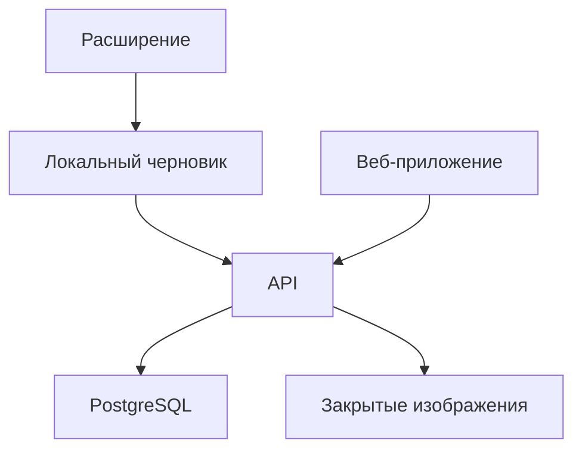

# Архитектура Flowix v2

Статус решений: архитектура утверждена для реализации основы; производственные адаптеры ещё не реализованы. Код текущего этапа не подключён к старому приложению.

## Состав

- **Extension:** Manifest V3 и TypeScript. Popup управляет записью; content script измеряет viewport и события; service worker проверяет источник, резервирует снимки и сохраняет результат. Жизненный цикл worker не является жизненным циклом записи.
- **Локальный черновик:** IndexedDB с изображениями и журналом; сохранение состояния через атомарную compare-and-swap транзакцию. Применение интерфейса SessionStore обязательно; обычного read/await/write в chrome.storage недостаточно.
- **Web:** Next.js/React, библиотека, редактор и плеер. Одна папка app, общие контракты. Внешний вид проектируется после первого полного сценария.
- **API:** Next.js Route Handlers; проверенная личность, членство, валидация, квота и идемпотентность. Долгие вычисления не выполняются в запросе.
- **Данные:** PostgreSQL, закрытое объектное хранилище. Для технического пилота сохраняется знакомый стек Supabase Auth/Postgres/Storage; текущий production-проект не переиспользуется без проверки. Размещение и условия обработки реальных клиентских данных требуют отдельного решения до их загрузки. В foundation нет привязки к конкретному провайдеру.

## Данные

`workspaces` и `workspace_members` задают доступ. Личный пользователь тоже имеет workspace, чтобы позже не менять владельца всех объектов ради команды.

`collections` содержат `flows`. `flow_versions` фиксируют опубликованный набор кадров. `frames` ссылаются на `assets`; `transitions` связывают соседние кадры и содержат нормализованный прямоугольник клика. `comments` привязаны к версии и кадру. `capture_receipts` обеспечивают идемпотентность, `usage` — квоты. Это целевая схема, SQL-миграций в текущем этапе ещё нет.

Кадр и действие — разные сущности. Массив картинок с одной точкой не считается полной моделью прототипа. Порядок кадров задаётся сохранённой последовательностью; время загрузки по сети не меняет порядок. В MVP один исходящий переход ведёт к следующему кадру. Никаких автоматически придуманных развилок.

## Протокол записи

1. Явное начало записи закрепляет сессию за вкладкой, окном и origin. Первый снимок создаёт исходное состояние.
2. Входящие сообщения проверяются по Chrome sender, top-level frame и текущему состоянию сессии. Значения из page payload не доказывают источник или разрешения.
3. Capture ID резервируется транзакцией до снимка. Пока снимок выполняется, второй не принимается; пропуск отображается. Задержанные клики нельзя превращать в снимки уже другого состояния.
4. Перед и после captureVisibleTab проверяются вкладка, документ, viewport и documentVersion. Последний меняется при наблюдаемых DOM-изменениях и scroll. Canvas, видео и нестабильные анимации требуют отдельной проверки: этот счётчик не является универсальным доказательством одинаковой картинки.
5. Снимок сохраняется локально с неизменяемым ID и SHA-256. Порядок и throttle переживают перезапуск worker. Прерванный capture не повторяется автоматически на новой странице; запись восстанавливается на паузе.
6. Область клика связывается с исходным кадром, следующий устойчивый снимок — с результатом. При сомнении создаётся черновик без связи и требуется проверка, а не неверный «готовый прототип». Ручной режим остаётся доступен.
7. После проверки и необратимого закрытия чувствительных областей отправляется очищенная версия. Очередь повторяет загрузку уже существующих байтов с тем же capture ID, а не делает новый снимок.

Текущий core проверяет состояние и метаданные; реализация Chrome, DOM-наблюдения, обработки изображения и IndexedDB — следующий этап. Проверки метаданных не означают, что захват в реальном браузере уже надёжен.

## Авторизация и доступ

- Одна проверяемая сервером web-сессия. Никаких `flowix-auth=1` как доказательства входа и поиска access token в localStorage страницы.
- Подключение расширения — поддерживаемый провайдером PKCE/OAuth flow с точным redirect allowlist и проверкой state. Вариант с одноразовым pairing требует отдельного протокола; произвольная передача bearer-токена через URL исключена.
- Пользователь определяется сервером из проверенного токена. Членство и роль читаются из БД для нужного workspace. Клиентские `ownerId`, `role` и user_metadata не авторизуют запрос.
- Owner управляет участниками, editor изменяет записи, viewer смотрит. Приватная ссылка не выдаёт доступ постороннему. Публичные share links откладываются.
- RLS и политики Storage воспроизводятся миграциями, проверяются двумя пользователями из разных workspace. Service key используется только там, где действительно нужны привилегии. Доступ не должен зависеть от случайно забытого фильтра в одном endpoint.
- Изображения выдаются только после проверки доступа; короткий срок подписанных URL ограничивает окно доступа после отзыва. Мгновенный отзыв уже скачанных байтов невозможен.

## Защита загрузок и расходов

До чтения тела запроса — ограничение размера на ingress. На сервере — лимит байтов, декодирование допустимого PNG/JPEG, предел пикселей, перекодирование, удаление ненужных метаданных, сверка хэша. MIME из multipart не считается проверкой содержимого.

Квота и создание receipt/кадра выполняются в транзакции. Повтор capture ID возвращает тот же результат; другой хэш с тем же ID возвращает конфликт. Политики БД не позволяют прямому клиентскому insert обойти серверный append. Незавершённые assets удаляются фоновым сборщиком; старые ревизии и сохранённые данные очищаются согласно явной политике.

Секреты — в конфигурации сервера, никогда в NEXT_PUBLIC, расширении или Git. Логи содержат технические IDs и коды ошибок, но не токены, изображения и исходные URL. Rate limit применяется по пользователю/workspace; IP — дополнительный сигнал. CORS не заменяет авторизацию.

## Приёмка полного сценария

Запись на SPA и обычном сайте; медленная сеть; быстрые клики; переключение вкладок; navigation; scroll; масштабирование; перезапуск worker; Stop во время capture; offline/retry; восстановление черновика; скрытие данных; просмотр вторым участником; отказ постороннему; отзыв доступа; удаление данных. Первые проверки используют синтетические или нечувствительные экраны.
